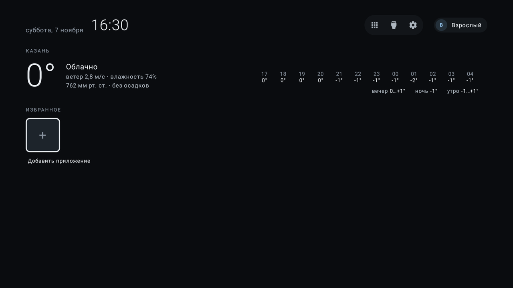
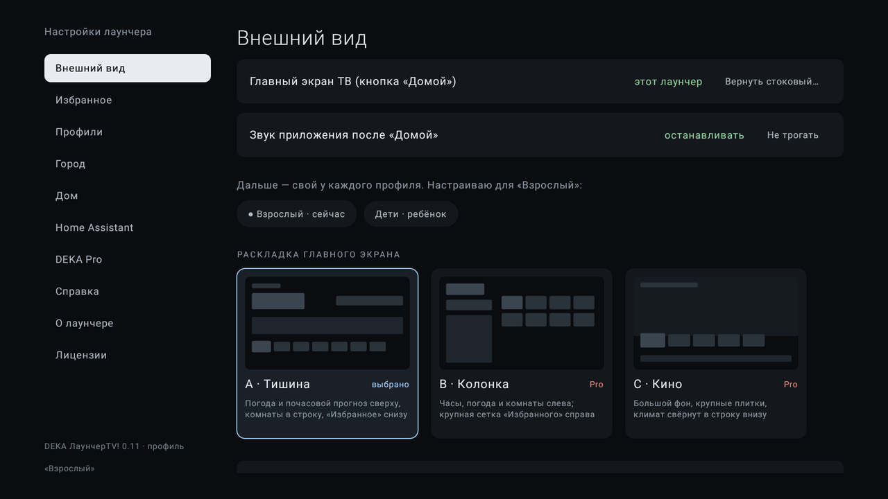

# DEKA ЛаунчерTV!

Главный экран для Android TV без рекламы: ваши приложения, погода и умный дом из Home Assistant — с пульта.

> *An ad-free home screen for Android TV with weather and Home Assistant. Russian UI only.*

В этом репозитории — **только релизы**: APK, описание версий и файл `version.json`, по которому лаунчер сам проверяет обновления. Исходный код закрыт.

<p align="center">
  
</p>
<p align="center">
  
</p>

## Возможности

- **«Избранное»** — ваши приложения плитками в нужном порядке, все приложения ТВ в одном списке.
- **Погода** — сейчас, по часам и на неделю для любого города России и СНГ или по координатам. Данные [MET Norway](https://api.met.no/).
- **Home Assistant** — температура и влажность по комнатам на главном экране, тревоги о протечке, дыме и газе, экран «Дом» со светом, отоплением, кондиционером, пылесосом и сценами. Подключение — к вашему серверу в домашней сети, токен вводится с телефона по QR.
- **Профили** — у каждого своё «Избранное» и вид; детский профиль без настроек и управления домом.
- **Три раскладки и фоны**, мастер первой настройки, полный сброс.
- **Обновления изнутри** — лаунчер сам находит новую версию, проверяет её и передаёт системному установщику.
- **Журнал сбоев** остаётся на ТВ; его можно открыть на телефоне по QR и приложить к сообщению об ошибке.

| Бесплатно | DEKA Pro (ключ на семью) |
|---|---|
| Раскладка «Тишина», «Избранное», все приложения | + раскладки «Колонка» и «Кино», все фоны |
| Погода сейчас, по часам, на неделю | + прогноз на 10 дней |
| Home Assistant: комнаты на главном, тревоги, «Дом» — просмотр | + управление устройствами с пульта |
| Один профиль | + профили для всей семьи и детский режим |

Ключ Pro проверяется на ТВ без интернета и без серверов. Условия покупки появятся вместе с публичной бетой.

## Требования

- Android TV / Google TV, **Android 9 и новее**.
- Проверен на Haier miniLED (Android TV 14) и эмуляторах Android TV 9 и 14.
- Интерфейс рассчитан на 720p, 1080p и 4K; масштаб подстраивается сам.

## Установка

1. Скачайте `DEKA-LauncherTV-vX.Y.apk` из [последнего релиза](../../releases/latest).
2. Установите любым удобным способом:
   - **с компьютера:** `adb install DEKA-LauncherTV-vX.Y.apk` (на ТВ включена «Отладка по сети» или USB);
   - **с флешки** через файловый менеджер ТВ;
   - **по ссылке** через приложение Downloader.
3. Откройте «DEKA ЛаунчерTV!» — запустится мастер первой настройки.

Дальше обновления ставятся из самого лаунчера: *настройки лаунчера → «О лаунчере» → «Обновления»*. При первом обновлении Android один раз спросит разрешение «Установка неизвестных приложений».

### Сделать главным экраном

На Android TV стоковый лаунчер Google имеет приоритет, и кнопка «Домой» открывает его, даже если выбран другой. Мастер и настройки лаунчера предложат системный выбор; если «Домой» всё равно ведёт на стоковый экран — отключите его один раз с компьютера:

```bash
adb connect <IP телевизора>
adb shell pm disable-user --user 0 com.google.android.tvlauncher
adb shell cmd package set-home-activity ru.dekan.tvlauncher/.MainActivity
```

Вернуть стоковый экран можно с пульта: *настройки ТВ → Приложения → «Android TV Home» → «Включить»* — или командой `adb shell pm enable com.google.android.tvlauncher`.

## Подлинность APK

Все релизы с версии 0.11 подписаны одним ключом. Сверить подпись:

```bash
apksigner verify --print-certs DEKA-LauncherTV-vX.Y.apk
```

Ожидаемый сертификат:

```
DN: CN=DEKA LauncherTV, O=DEKA, C=RU
SHA-256: 3e24772b87aeff07366c473ccc5213d4d48f645e0238a84cea4dd3b9514bb75a
```

Контрольные суммы файлов — в `SHA256SUMS.txt` каждого релиза. Лаунчер при обновлении сам проверяет и SHA-256 файла, и то, что подпись совпадает с установленной версией.

> Версии до 0.11 подписывались другим ключом. Поверх них 0.11 не ставится — нужно удалить старую версию и установить новую (настройки придётся задать заново).

## Конфиденциальность

Лаунчер не собирает аналитику и не отправляет данные о вас или о ТВ. В сеть уходят только:

| Куда | Зачем | Что передаётся |
|---|---|---|
| `api.met.no` | прогноз погоды | координаты выбранного города, название и версия приложения |
| ваш Home Assistant | комнаты и устройства | запросы с вашим токеном, только в домашней сети |
| `github.com` | проверка обновлений (раз в сутки, отключается) | обычный запрос файла `version.json` |

Список городов встроен в приложение. Токен Home Assistant хранится в зашифрованном виде (Android Keystore). Журнал сбоев не покидает ТВ, пока вы сами не откроете его по QR.

## Сообщить об ошибке

[Создайте issue](../../issues/new/choose) по шаблону. Очень помогает журнал сбоев: *настройки лаунчера → «О лаунчере» → «Журнал сбоев» → «На телефон (QR)» → «Скопировать»*. Токены и ключи из журнала вырезаются автоматически.

Уязвимости — не в открытые issue, а по [SECURITY.md](SECURITY.md).

## Для разработчиков: `version.json`

Формат файла, по которому лаунчер ищет обновления, описан в [docs/version-json.md](docs/version-json.md).

## Благодарности

- Прогноз погоды — [MET Norway](https://api.met.no/) (CC BY 4.0).
- Список городов — [GeoNames](https://www.geonames.org/) (CC BY 4.0).
- QR-коды — [ZXing](https://github.com/zxing/zxing) (Apache 2.0).
- Интерфейс — Jetpack Compose for TV (Apache 2.0).

Полный список лицензий — в самом лаунчере: *настройки → «Лицензии»*.

## Лицензия

© 2026 DEKA. Все права защищены. Бесплатную версию можно свободно устанавливать и использовать; распространять APK — только без изменений и со ссылкой на этот репозиторий. Подробнее — [LICENSE.md](LICENSE.md).
